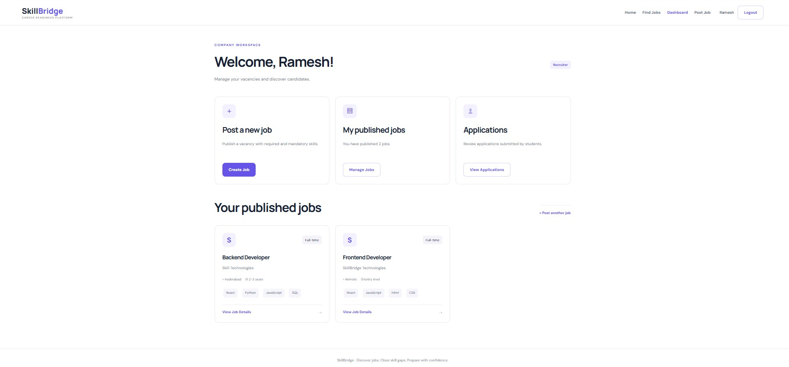
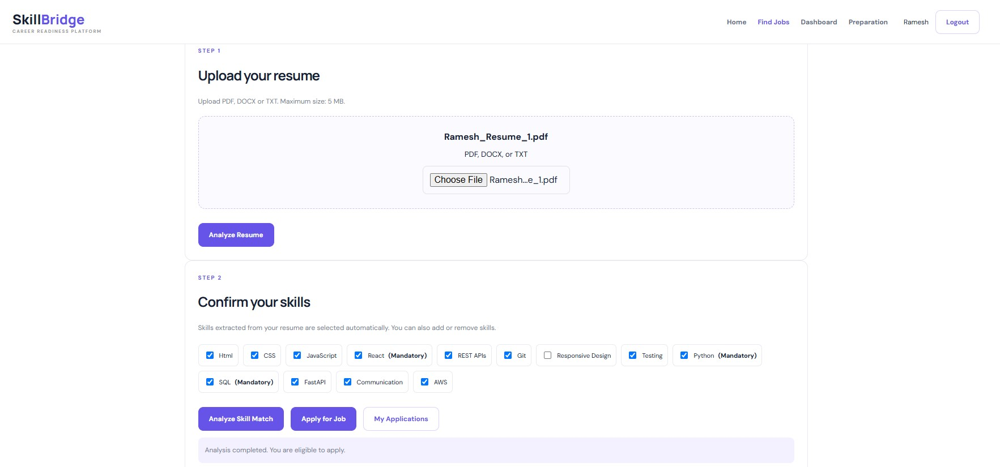

# SkillBridge – AI-Powered Student–Job Matching Platform

SkillBridge is an AI-powered platform designed to bridge the gap between students and recruiters by connecting candidate skills with industry job requirements.

The platform helps students identify missing skills, discover suitable job opportunities, prepare for interviews, and improve their employability. Recruiters can publish job openings and manage applications.

## Live Demo

- **Frontend:** https://skill-bridge-4lfeewej6-skill-bridge-2aca.vercel.app/
- **Backend API:** https://skillbridge-backend-tdm4.onrender.com
- **API Documentation:** https://skillbridge-backend-tdm4.onrender.com/docs

## Screenshots

### Home Page


### Student Dashboard


### Recruiter Dashboard


### Skill Matching


### AI Mentor


## Key Features

### Student / Job Seeker
- User registration and secure login.
- Resume upload and skill extraction.
- Browse and search job opportunities.
- Compare candidate skills with job requirements.
- Identify matched and missing skills.
- Receive personalized learning recommendations.
- AI-powered interview preparation.
- AI Mentor for career and technical guidance.
- Apply for jobs and track applications.

### Recruiter / Company
- Recruiter registration and login.
- Company profile management.
- Create and publish job openings.
- Update and delete job postings.
- View applicants and manage applications.
- View and download applicant resumes.

### AI Capabilities
- Gemini-powered AI Mentor.
- Dynamic interview preparation.
- Skill gap analysis.
- Personalized study guidance.
- PDF study guide generation.

## Technology Stack

| Component | Technologies |
|---|---|
| Frontend | React, JavaScript, HTML, CSS |
| Frontend tooling | Vite |
| Backend | Python, FastAPI |
| Database | SQLite (local), PostgreSQL (deployment) |
| ORM | SQLAlchemy |
| AI | Google Gemini API |
| Authentication | JWT |
| Resume processing | PyPDF, python-docx |
| PDF generation | ReportLab |

## Project Structure

```text
SkillBridge/
├── backend/
│   ├── app/
│   │   ├── main.py
│   │   ├── database.py
│   │   ├── models.py
│   │   ├── schemas.py
│   │   ├── security.py
│   │   ├── interview_ai.py
│   │   ├── skill_matcher.py
│   │   └── pdf_generator.py
│   ├── requirements-deploy.txt
│   └── .env.example
│
├── frontend/
│   ├── src/
│   ├── public/
│   ├── package.json
│   └── vite.config.js
│
├── screenshots/
│   ├── home-page.jpg
│   ├── student-dashboard.jpg
│   ├── recruiter-dashboard.jpg
│   ├── skill-matching.jpg
│   └── ai-mentor.jpg
│
├── .gitignore
└── README.md
```

## Local Installation and Setup

### 1. Clone the repository

```bash
git clone https://github.com/rameshreddyeedula/SkillBridge.git
cd SkillBridge
```

### 2. Backend Setup

Navigate to the backend folder:

```bash
cd backend
```

Create a Python virtual environment:

```bash
python -m venv .venv
```

Activate the virtual environment on Windows:

```powershell
.\.venv\Scripts\Activate.ps1
```

Install dependencies:

```bash
pip install -r requirements-deploy.txt
```

Create a `.env` file using `.env.example` as a reference and configure the required environment variables.

Start the backend server:

```bash
python -m uvicorn app.main:app --reload --host 127.0.0.1 --port 8000
```

Backend API documentation:

http://127.0.0.1:8000/docs

### 3. Frontend Setup

Open another terminal and navigate to the frontend folder:

```bash
cd frontend
```

Install dependencies:

```bash
npm install
```

Create a `.env` file inside the frontend folder:

```env
VITE_API_BASE_URL=http://127.0.0.1:8000
```

Start the frontend development server:

```bash
npm run dev
```

Frontend development URL:

http://localhost:5173

## Environment Variables

Configure the following variables in your backend environment:

| Variable | Purpose |
|---|---|
| DATABASE_URL | Database connection |
| JWT_SECRET | Authentication secret |
| JWT_EXPIRE_MINUTES | JWT expiration |
| GEMINI_API_KEY | Gemini API authentication |
| GEMINI_MODEL | Gemini model selection |
| ALLOW_OLLAMA_FALLBACK | Enable or disable local Ollama fallback |
| UPLOAD_DIR | Resume upload directory |
| MAX_UPLOAD_MB | Maximum resume upload size |

**Security:** Never commit real API keys, passwords, database credentials, or other secrets to GitHub.

## Deployment Architecture

- **GitHub:** Source code repository.
- **Render:** FastAPI backend and PostgreSQL database.
- **Vercel:** React frontend.

## Project Objective

To create an intelligent platform that improves student employability by identifying skill gaps, recommending learning resources, and connecting qualified candidates with relevant job opportunities.

## Author

**Ramesh Reddy Eedulakanti**

GitHub: https://github.com/rameshreddyeedula

---

**SkillBridge – Bridging the gap between skills and opportunities.**
