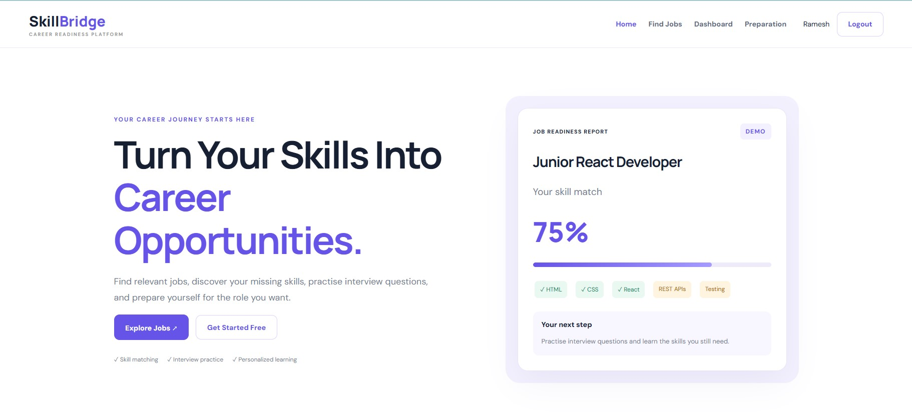
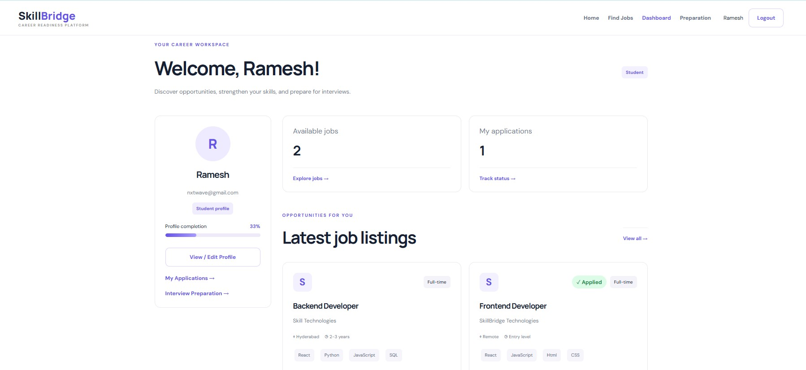
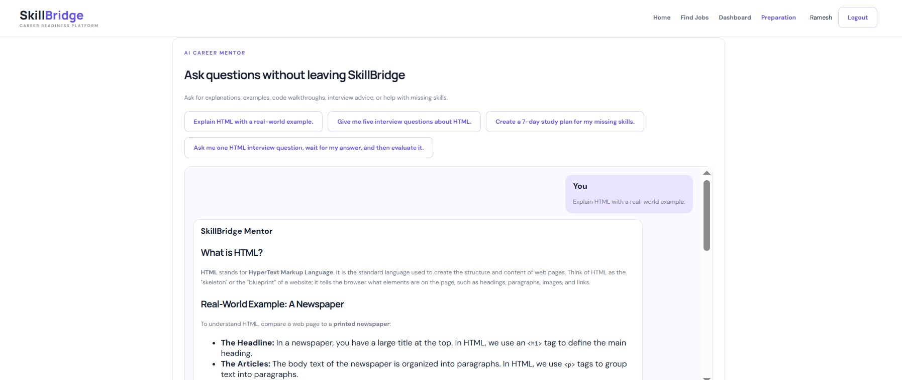

# SkillBridge – AI-Powered Student–Job Matching Platform

**Bridging the gap between student skills and industry opportunities.**

SkillBridge is an AI-powered student–job matching platform that connects students with relevant career opportunities by analyzing their skills against real-world job requirements.

Many students struggle to identify the skills employers expect and understand what they need to improve before applying for jobs. SkillBridge addresses this challenge through resume analysis, intelligent skill matching, personalized learning recommendations, and AI-powered interview preparation.

The platform also enables recruiters to publish job openings, discover applicants, and manage candidate applications through a centralized dashboard.

## 🚀 Live Demo

| Component | Link |
|---|---|
| **Live Application** | [Open SkillBridge](https://skill-bridge-4lfeewej6-skill-bridge-2aca.vercel.app/) |
| **Backend API** | [View API](https://skillbridge-backend-tdm4.onrender.com) |
| **API Documentation** | [Explore API Docs](https://skillbridge-backend-tdm4.onrender.com/docs) |
| **GitHub Repository** | [View Source Code](https://github.com/rameshreddyeedula/SkillBridge) |

## 📸 Application Preview

### Home Page


### Student Dashboard


### Recruiter Dashboard


### Intelligent Skill Matching


### AI Mentor


## ✨ Key Features

### 🎓 Student / Job Seeker Module

- **Secure Authentication:** Register and log in to access a personalized student dashboard.
- **Resume Analysis:** Upload resumes and extract relevant candidate skills.
- **Job Discovery:** Browse and search available job opportunities.
- **Intelligent Skill Matching:** Compare extracted candidate skills with employer requirements.
- **Skill Gap Analysis:** Identify matching skills and missing skills for individual job opportunities.
- **Learning Recommendations:** Discover areas to improve based on identified skill gaps.
- **AI Interview Preparation:** Generate interview preparation content based on relevant skills.
- **AI Mentor:** Get technical and career guidance through an integrated AI assistant.
- **Application Tracking:** Apply for jobs and monitor application status.

### 🏢 Recruiter / Company Module

- Recruiter registration and authentication.
- Company profile management.
- Create, publish, update, and delete job postings.
- Define job descriptions and required skills.
- View applicants for published positions.
- Access and download applicant resumes.
- Manage candidate applications.

### 🤖 AI-Powered Capabilities

SkillBridge integrates Google Gemini AI to provide intelligent career assistance.

- AI-powered career and technical guidance.
- Dynamic interview question preparation.
- Skill gap analysis to highlight areas for improvement.
- Personalized study guidance.
- PDF study guide generation.

## 🧠 How SkillBridge Works

The platform follows a simple workflow to connect student capabilities with employer expectations.

1. **Student Registration:** Students create an account and access their dashboard.
2. **Resume Upload:** Students upload their resumes for skill extraction.
3. **Job Selection:** Students explore available job opportunities.
4. **Skill Comparison:** The platform compares candidate skills with the skills required by the selected job.
5. **Skill Gap Identification:** Students can understand their matching skills and identify missing skills.
6. **AI-Based Preparation:** Students receive relevant interview preparation and learning guidance.
7. **Job Application:** Students can apply for suitable opportunities and track their applications.

Recruiters can independently create job postings and review applicants through their dashboard.

## 🛠️ Technology Stack

| Layer | Technologies |
|---|---|
| Frontend | React, JavaScript, HTML, CSS |
| Frontend Tooling | Vite |
| Backend | Python, FastAPI |
| Database | SQLite (local), PostgreSQL (deployment) |
| ORM | SQLAlchemy |
| AI Integration | Google Gemini API |
| Authentication | JWT |
| Resume Processing | PyPDF, python-docx |
| PDF Generation | ReportLab |
| Version Control | Git, GitHub |
| Deployment | Vercel, Render |

## 📂 Project Structure

```text
SkillBridge/
├── backend/
│   ├── app/
│   │   ├── main.py
│   │   ├── database.py
│   │   ├── models.py
│   │   ├── schemas.py
│   │   ├── security.py
│   │   ├── interview_ai.py
│   │   ├── skill_matcher.py
│   │   └── pdf_generator.py
│   ├── requirements-deploy.txt
│   └── .env.example
│
├── frontend/
│   ├── src/
│   ├── public/
│   ├── package.json
│   └── vite.config.js
│
├── screenshots/
├── .gitignore
└── README.md
```

## ⚙️ Run Locally

### Prerequisites

- Python 3.10 or later
- Node.js and npm
- Git
- Google Gemini API key for AI features

### 1. Clone the Repository

```bash
git clone https://github.com/rameshreddyeedula/SkillBridge.git
cd SkillBridge
```

### 2. Backend Setup

```bash
cd backend

python -m venv .venv
```

Activate the virtual environment on Windows:

```powershell
.venv\Scripts\Activate.ps1
```

Install dependencies:

```bash
pip install -r requirements-deploy.txt
```

Create a `.env` file using `.env.example` as a reference and configure the required variables.

Start the backend:

```bash
python -m uvicorn app.main:app --reload --host 127.0.0.1 --port 8000
```

Backend documentation: http://127.0.0.1:8000/docs

### 3. Frontend Setup

Open another terminal:

```bash
cd frontend
npm install
```

Create a `.env` file inside the frontend directory:

```env
VITE_API_BASE_URL=http://127.0.0.1:8000
```

Start the frontend:

```bash
npm run dev
```

Frontend URL: http://localhost:5173

## 🔐 Environment Configuration

Configure the following variables in the backend `.env` file:

| Variable | Purpose |
|---|---|
| `DATABASE_URL` | Database connection string |
| `JWT_SECRET` | Secret used for authentication tokens |
| `JWT_EXPIRE_MINUTES` | Authentication token expiry |
| `GEMINI_API_KEY` | Google Gemini API authentication |
| `GEMINI_MODEL` | AI model selection |
| `ALLOW_OLLAMA_FALLBACK` | Controls local Ollama fallback |
| `UPLOAD_DIR` | Resume upload directory |
| `MAX_UPLOAD_MB` | Maximum permitted resume upload size |

**Security:** Never commit `.env` files, API keys, passwords, JWT secrets, or database credentials to GitHub.

## ☁️ Deployment Architecture

| Service | Responsibility |
|---|---|
| GitHub | Source code management |
| Vercel | React frontend hosting |
| Render | FastAPI backend hosting |
| PostgreSQL | Production database |

## 🎯 Project Vision

SkillBridge aims to make career preparation more accessible and structured by helping students understand employer expectations, identify skill gaps, prepare for interviews, and discover relevant job opportunities.

By combining AI assistance with skill-based job matching, the platform creates a connection between learning, career preparation, and employment.

## 👨‍💻 Developed By

**Ramesh Reddy Eedulakanti**

- GitHub: [rameshreddyeedula](https://github.com/rameshreddyeedula)
- Project: [SkillBridge Repository](https://github.com/rameshreddyeedula/SkillBridge)

---

**SkillBridge – Turning Skills into Opportunities.**
